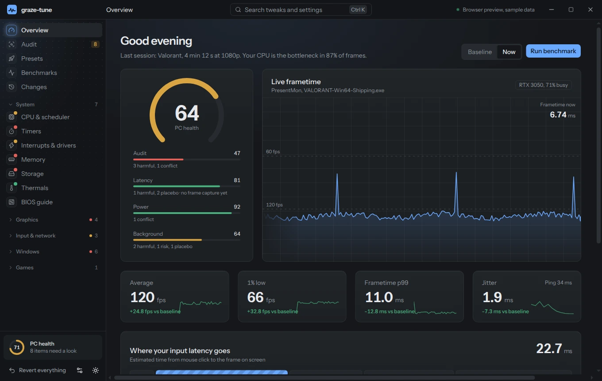

# Graze Tune

Graze Tune is a Windows app for checking gaming-related settings, trying a change, and measuring what it did. Start with a baseline before changing anything.

[Windows releases](https://github.com/lainarchive/graze-tune/releases) · [Build from source](#build-from-source)



*Browser preview with sample data. The numbers shown are not benchmark results.*

## What you can do

- Run a read-only audit of settings such as the registry, power plans, scheduled tasks and NVIDIA profiles.
- Apply individual tweaks or presets. Graze Tune records previous values for the changes it applies; use **Changes** to revert them.
- Compare runs using frametimes, TCP latency and jitter, or timer resolution.

## Install

Download the setup `.exe` from [Releases](https://github.com/lainarchive/graze-tune/releases) when a Windows installer is available. Installed copies can check for updates under **Settings → Updates**. If no installer is listed, build from source below.

The release installer doesn't include PresentMon. For frametime capture, build from source with the Intel PresentMon 2.x console executable.

## Build from source

On Windows, install Node.js 22 and the [Tauri prerequisites](https://v2.tauri.app/start/prerequisites/#windows). From the repository root:

```sh
npm ci
npx tauri build --config src-tauri/tauri.unsigned.conf.json
```

This builds a local NSIS installer without updater signatures. Find it in `target/release/bundle/nsis`.
To include frametime capture, place `PresentMon.exe` in [resources/](resources/) before building.

## Development

`npm run dev` opens a browser preview with sample data. It doesn't read or change Windows settings. Use `npx tauri dev` on Windows for the desktop app.

The Rust engine and tweak catalog live in [crates/engine](crates/engine/), the desktop shell in [src-tauri](src-tauri/), and the React UI in [src](src/).
After changing the tweak catalog, refresh the preview data:

```sh
cargo run -p graze-engine --example export_catalog > src/data/catalog.json
```

The [release workflow](.github/workflows/release.yml) runs on `vX.Y.Z` tags and uses the `TAURI_SIGNING_PRIVATE_KEY` Actions secret to sign updates. Bump the version in `Cargo.toml` and `src-tauri/tauri.conf.json` before tagging.

## Credits

[OptimizerDuck](https://github.com/itsfatduck/optimizerDuck) was a reference for which Windows settings to include in the tweak catalog.
